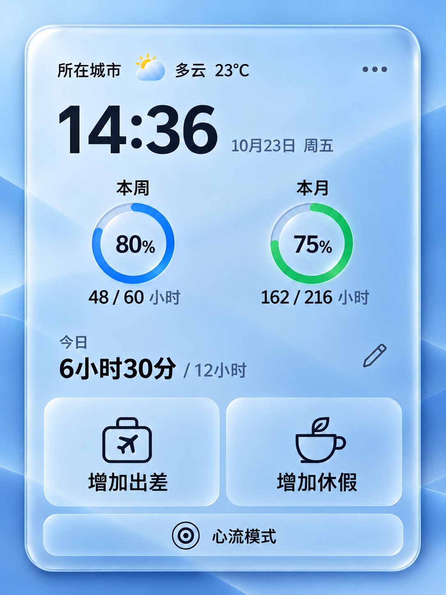
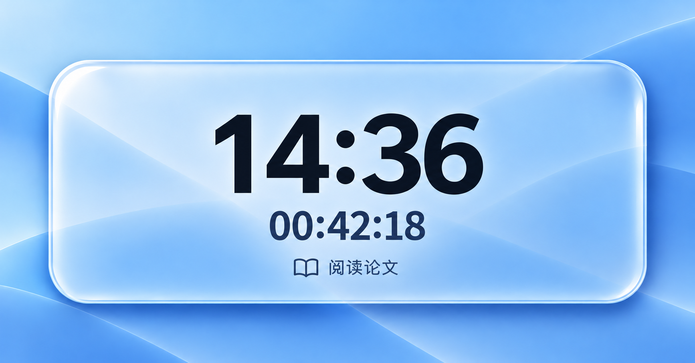

# 桌面打卡与心流面板

v0.8.30：一整块中性半透明玻璃，细光边、蓝／青绿圆环和轻透明操作区。字体、图标和布局均原生实现。九页最新效果图见 [设计总览](v0.8.29/index.html)。

- 常规面板设计基准为 420 × 614，显示时保持参考图比例。默认自动适配屏幕，通常以 75% 显示为 315 × 460.5；设置中可选择 60%–100% 等比例缩放，文字、图标、按钮及录入弹层一起调整。周、月双环分别为蓝、绿，圆环显示百分比。周按周一至周日统计，跨月保留完整七天，日期范围在圆环悬停与明细页同步显示。
- 今日录入采用起止时间，支持多段和跨午夜，自动累加；出差和休假直接使用现有记录与扣减规则。
- 心流面板设计基准为 420 × 192，沿用同一个缩放比例，保留当前时间、持续时间和可选专注事项。心流不创建任何打卡记录。
- 原生窗口保持透明，不铺设覆盖外侧留白的系统背景；玻璃面板自身只保留细高光与轻阴影。
- 点击即开始心流；正常内容先淡出，原时钟连续移位，玻璃面板收拢，计时与事项随后出现。左上角锚点保持不变。退出反向展开；减少动态效果时缩短为简单过渡。
- 心流右上角保留结束按钮，Escape 也可结束。首次选择天气城市，选择结果与面板设置存在本地。
- 登录启动只显示桌面小窗；普通启动保留主工作台。托盘可重新显示面板、打开工作台或退出应用。

视觉参考由内置 ImageGen 生成，图中时间、天气与数字均为示例。实际软件保持原生文字与交互，不将图像作为界面。

以下为保留的早期概念图，当前设计以 v0.8.29 总览为准。

天气数据来自 [Open-Meteo](https://open-meteo.com/)，城市数据来自 [GeoNames](https://www.geonames.org/)。天气需要联网，记录与设置在本机保存。天气不可用时保留上次值并标注未更新。

最新版页面效果图见 [v0.8.29 设计总览](v0.8.29/index.html)，包含主面板、周／月明细、打卡、出差、休假、城市、设置、心流共九页。
